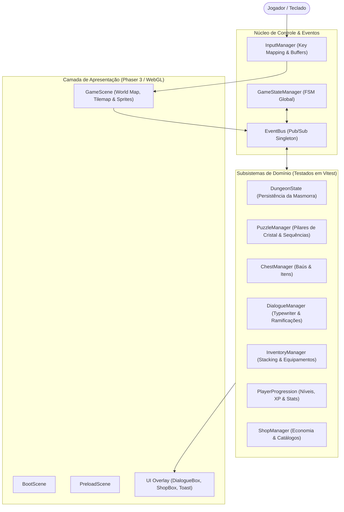

# ⚔️ Cinzas do Éter — JRPG 16-Bit Original

[](https://wallacextreme.github.io/cinzas-do-eter/)
[](https://www.typescriptlang.org/)
[](https://phaser.io/)
[](https://vitejs.dev/)
[](https://vitest.dev/)
[](LICENSE)

**Cinzas do Éter** é um RPG clássico com estética 16-bit desenvolvido em **TypeScript estrito** sobre o framework **Phaser 3**, priorizando engenharia desacoplada, arquitetura orientada a eventos, gerenciamento determinístico de estado de jogo e rigorosa suíte de testes com **Vitest** (+370 testes automatizados).

---

## 🌐 Demonstração Online & Links

- 🎮 **Demo Interativa no GitHub Pages:** [https://wallacextreme.github.io/cinzas-do-eter/](https://wallacextreme.github.io/cinzas-do-eter/)
- 💻 **Repositório GitHub Oficial:** [https://github.com/wallacextreme/cinzas-do-eter](https://github.com/wallacextreme/cinzas-do-eter)

---

## 🎯 Visão Geral & Decisões Arquiteturais

O objetivo do projeto é demonstrar a aplicação de princípios maduros de engenharia de software no ecossistema de Game Development:
1. **Desacoplamento Total entre Domínio e Renderização:** As regras de transição de mapas, quebra-cabeças, baús, progressão de atributos e economia não dependem das classes visuais do Phaser, permitindo que **370 testes rodem em segundos** via Vitest sem necessidade de canvas real.
2. **Arquitetura Orientada a Eventos:** Comunicação entre subsistemas através de um `EventBus` singleton fortemente tipado.
3. **Máquina de Estados Finita (FSM):** O `GameStateManager` controla estritamente o ciclo de vida (`BOOT` $\rightarrow$ `LOADING` $\rightarrow$ `EXPLORING` $\rightarrow$ `DIALOGUE` $\rightarrow$ `MENU` $\rightarrow$ `CUTSCENE`).

---

## 🏗️ Diagrama de Arquitetura



---

## ⚡ Sistemas Implementados & Cobertura de Testes

- **🗺️ Exploração e Transições Matriciais:** `MapTransitionManager` com teletransporte assíncrono entre vilarejos (`LumenVillage`), planícies (`AshPlains`) e câmaras subterrâneas (`EchoCave` R1 a R7).
- **🔮 Masmorras & Quebra-Cabeças Interativos:** Pilares de cristal elementais com validação de sequência, detecção de erros e ativação de pontes de éter.
- **💬 Diálogos com Typewriter & NPCs:** Sinalização contextual de placas, caixas de diálogo responsivas e interação com personagens não-jogáveis.
- **🎒 Inventário, Equipamentos e Loja:** Gestão de consumíveis com efeitos imediatos de cura/mana, slots de equipamentos com cálculo dinâmico de atributos e comércio.
- **💾 Sistema de Salvamento Local:** `SaveManager` com serialização imutável, slots múltiplos e validação de integridade contra corrupção.

---

## 🧪 Qualidade de Software & Testes Automatizados

A suíte completa de testes unitários e de integração é executada via **Vitest**:

```bash
$ bun run test
 ✓ tests/utils/math.test.ts (21 tests)
 ✓ tests/entities/PlayerProgression.test.ts (19 tests)
 ✓ tests/world/AshPlainsMap.test.ts (10 tests)
 ✓ tests/systems/EquipmentManager.test.ts (47 tests)
 ✓ tests/shop/ShopManager.test.ts (19 tests)
 ✓ tests/systems/StatusManager.test.ts (19 tests)
 ✓ tests/inventory/InventoryManager.test.ts (21 tests)
 ✓ tests/world/EchoCavePuzzleIntegration.test.ts (7 tests)
 ✓ tests/world/DialogueManager.test.ts (8 tests)
 ✓ tests/save/SaveManager.test.ts (5 tests)
 ✓ tests/world/ChestManager.test.ts (5 tests)
 ✓ tests/core/GameStateManager.test.ts (6 tests)
 ✓ tests/core/EventBus.test.ts (9 tests)
 ...
 Test Files  41 passed (41)
      Tests  370 passed (370)
   Duration  6.04s
```

---

## 💻 Como Executar Localmente

### 1. Clonar o Repositório
```bash
git clone https://github.com/wallacextreme/cinzas-do-eter.git
cd cinzas-do-eter
```

### 2. Instalar Dependências
```bash
bun install
```

### 3. Executar Servidor de Desenvolvimento
```bash
bun run dev
```
Abra `http://localhost:5173` no navegador.

### 4. Executar os Testes Automatizados
```bash
bun run test
```

### 5. Compilar Bundle de Produção
```bash
bun run build
```
O build estático otimizado será gerado na pasta `dist/`.

---

## 👤 Autor

Desenvolvido por **Wallace Soares**
- **GitHub:** [@wallacextreme](https://github.com/wallacextreme)
- **LinkedIn:** [wallacextreme](https://linkedin.com/in/wallacextreme)
- **Portfólio:** [https://wallacextreme.github.io/portfolio/](https://wallacextreme.github.io/portfolio/)

---

## 📄 Licença

Distribuído sob a licença **MIT**. Consulte `LICENSE` para mais detalhes.
